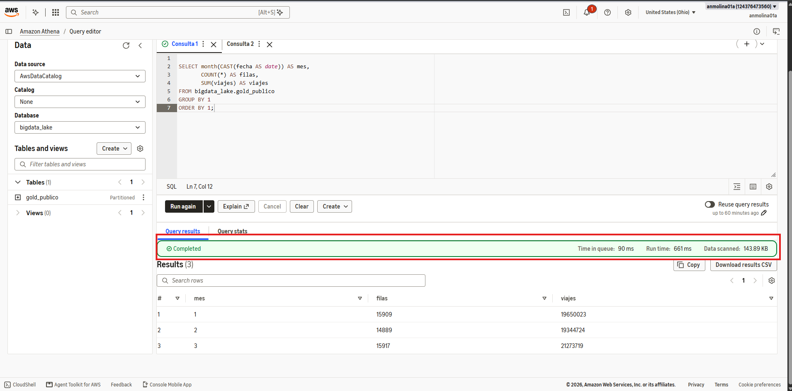

# Retos opcionales · Taller 1

Equipo: Valentina Restrepo Arboleda y Andres Fernando Molina Orozco.  Los retos suman hasta +15 puntos (los puntos de los seis suman 17; el máximo que se acredita es 15).
Marca los que hicieron y di dónde está cada uno.

| Id | Reto | Pts | ¿Hecho? | Dónde está (archivo y línea o sección) |
|---|---|---|---|---|
| R1 | Un segundo caso completo (cinco preguntas más) | 3 | Sí |En [`05_retos.sql`](05_retos.sql) (sección R1). |
| R2 | `DIM_FECHA` con festivos y fin de semana, usada en una consulta | 2 | Sí | En [`05_retos.sql`](05_retos.sql) (sección R2). |
| R3 | Lluvia fuerte (más de 10 mm) frente a la línea base del mismo día de la semana (`AVG() OVER (PARTITION BY ZONA, DIA_SEMANA)`) | 3 | Sí | En [`05_retos.sql`](05_retos.sql) (sección R3). |
| R4 | Suite de chequeos (grano, huérfanos, reconciliación con el conteo del paquete) en un solo archivo ejecutable | 3 | Sí | En [`04_chequeos.sql`](04_chequeos.sql) (uso de UNION ALL para consolidar validaciones). |
| R5 | Rachas de alta demanda (días consecutivos sobre un umbral; el problema de «huecos e islas») | 3 | Sí | En [`05_retos.sql`](05_retos.sql) (sección R5). |
| R6 | Tabla externa de Athena sobre el paquete (la del Lab 4, E7) y reconciliación de conteos con Snowflake: filas por mes y viajes totales, con captura de `Data scanned` | 3 | sí | Tabla evidencia en el presente archivo, en [`Imagen athenea`](AthenaDataScaned.png) |

Para R6, si lo hacen: pega aquí la reconciliación (filas por mes y viajes totales en Athena y en Snowflake) y guarda la captura de `Data scanned` en esta carpeta.
Se muestra resultado de Athena 

Tabla comparativa con resultados para el reto R6 Snowflake vs Athenea

| Mes | Filas Athena | Filas Snowflake | Viajes Athena | Viajes Snowflake | ¿Coinciden? |
|---|---|---|---|---|---|
| ENERO | 15.909 | 15.909 | 19.650.023 | 19.650.023 | SI |
| FEBRERO | 14.889 | 14.889 | 19.344.724 | 19.344.724 | SI |
| MARZO | 15.917 | 15.917 | 21.273.719 | 21.273.719 | SI |
| TOTAL | 46.715 | 46.715 | 60.268.466 | 60.268.466 | SI |

Coinciden en valores por lo que se confirma que Tabla externa de Athena sobre el paquete (la del Lab 4, E7) y reconciliación de conteos con Snowflake: filas por mes y viajes totales esta correcta.

