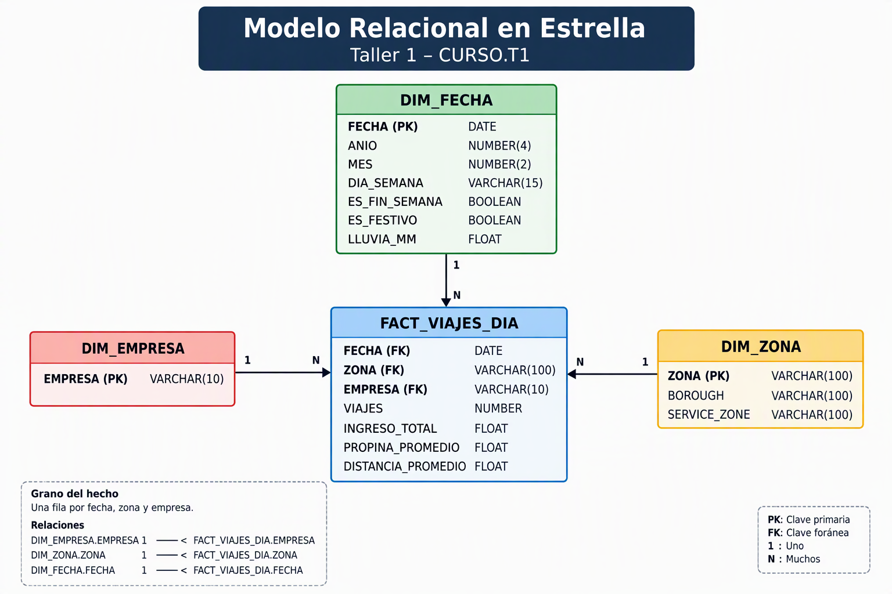
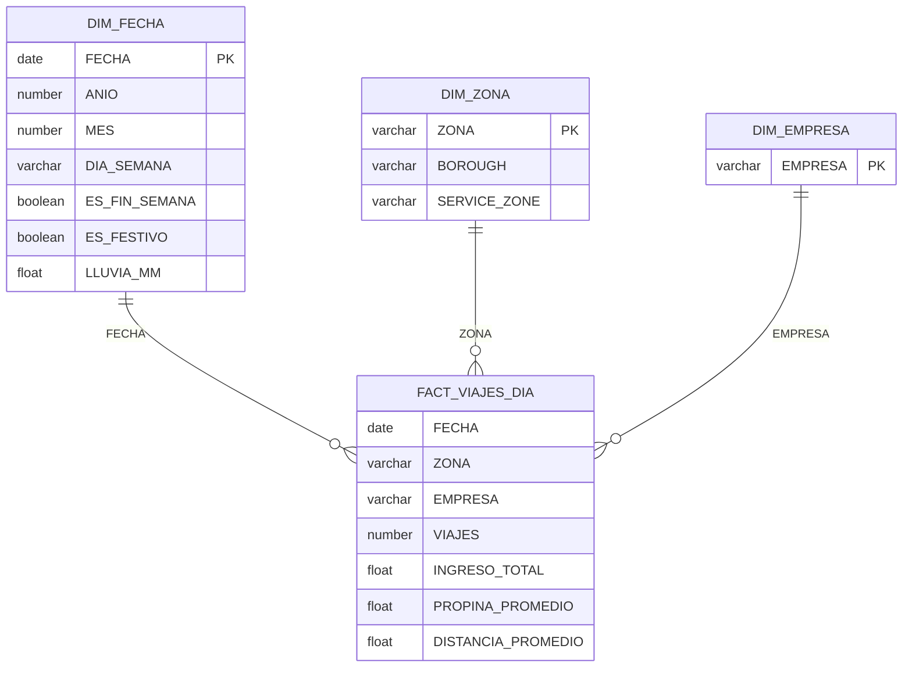

# Diagrama de la estrella · Taller 1

Equipo: Valentina Restrepo Arboleda y Andres Fernando Molina Orozco.

Grano: Una fila por fecha, zona y empresa.

## Claves

| Dimensión | Llave en el hecho | Unión con el hecho | Por qué es única en la dimensión |
|---|---|---|---|
| DIM_FECHA | FECHA | `FACT.FECHA = DIM_FECHA.FECHA` | Se genera un registro por día calendario entre el primero y el último del gold (91 días). |
| DIM_ZONA | ZONA | `FACT.ZONA = DIM_ZONA.ZONA` | `SELECT DISTINCT ZONA, BOROUGH, SERVICE_ZONE` deja 261 filas, una por nombre. Los dos nombres repetidos comparten distrito y tipo de zona. |
| DIM_EMPRESA | EMPRESA | `FACT.EMPRESA = DIM_EMPRESA.EMPRESA` | `SELECT DISTINCT` sobre el gold; el origen no trae identificador y solo existen Uber y Lyft. |
 
La clave del hecho es compuesta (FECHA, ZONA, EMPRESA) y declara el grano.

