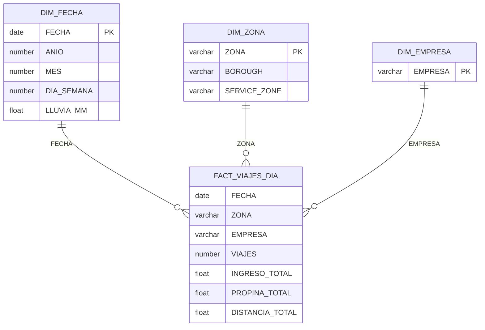

# Diagrama de la estrella · Taller 1

Equipo: Valentina Restrepo Arboleda y Andres Fernando Molina Orozco.

Grano: Una fila por fecha de recogida, zona de origen y empresa de plataforma.

Reemplaza el diagrama de abajo por el de tu estrella: una tabla de hechos al centro y al menos dos
dimensiones, cada una con su clave. GitHub dibuja el bloque `mermaid` al abrir este archivo. Si
prefieres una imagen, súbela como `diagrama.png` a esta carpeta y deja aquí un enlace a ella.

## Claves

| Dimensión | Clave | Por qué es única |
|---|---|---|
| DIM_FECHA | FECHA | Se generó secuencialmente asegurando un único registro por cada día calendario del trimestre. |
| DIM_ZONA | ZONA | Se agrupó usando GROUP BY ZONA, eliminando los LOCATION_ID duplicados para garantizar granularidad única por nombre. |
| DIM_EMPRESA | EMPRESA | Se construyó con un SELECT DISTINCT EMPRESA garantizando que solo existan Uber y Lyft una sola vez. |
