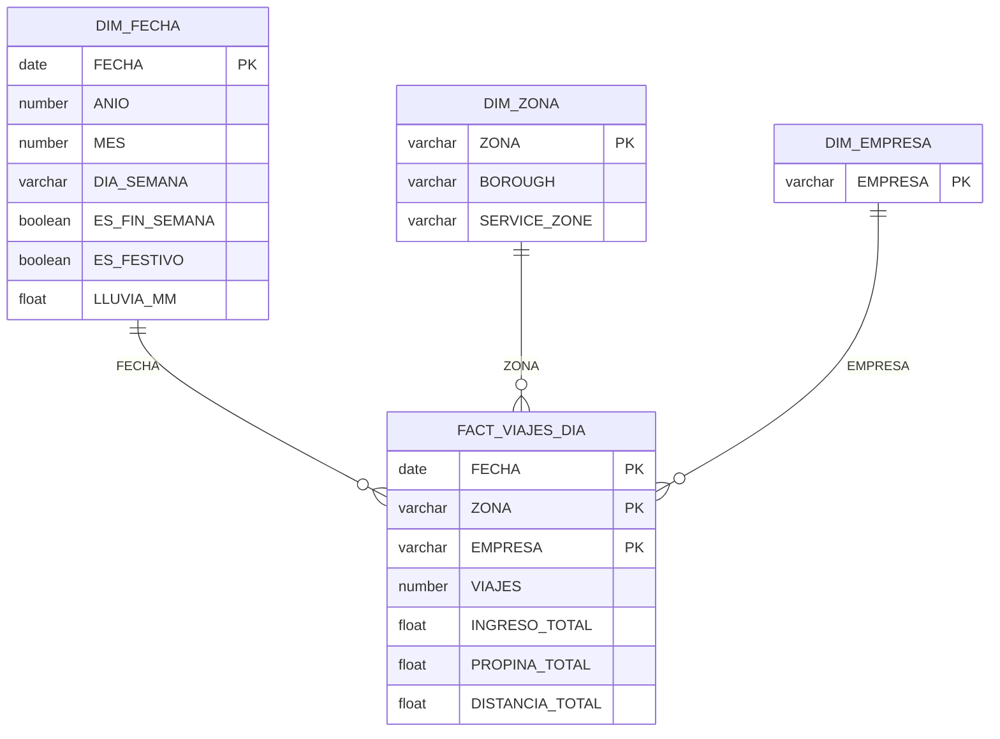

# Diagrama de la estrella · Taller 1

Equipo: Valentina Restrepo Arboleda y Andres Fernando Molina Orozco.

Grano: una fila por fecha, zona de recogida y empresa. Cada fila resume los viajes de una empresa en una zona durante un día.

## Medidas del hecho

Las medidas son aditivas: se pueden sumar entre filas sin distorsionar el resultado.

| Medida | Cómo se calcula en la carga | Para qué sirve |
|---|---|---|
| `VIAJES` | Tal cual viene del gold | Volumen y cuota de mercado |
| `INGRESO_TOTAL` | Tal cual viene del gold | Ingresos por empresa, mes o zona |
| `PROPINA_TOTAL` | `PROPINA_PROMEDIO * VIAJES` | Propina promedio ponderada: `SUM(PROPINA_TOTAL) / SUM(VIAJES)` |
| `DISTANCIA_TOTAL` | `DISTANCIA_PROMEDIO * VIAJES` | Distancia promedio ponderada: `SUM(DISTANCIA_TOTAL) / SUM(VIAJES)` |

La lluvia no está en el hecho: va en `DIM_FECHA`, una vez por día. Sumarla en el hecho contaría la misma lluvia tantas veces como filas tenga el día.

## Claves

| Dimensión | Llave en el hecho | Unión con el hecho | Por qué es única en la dimensión |
|---|---|---|---|
| DIM_FECHA | FECHA | `FACT.FECHA = DIM_FECHA.FECHA` | Se genera un registro por día calendario entre el primero y el último del gold (91 días). |
| DIM_ZONA | ZONA | `FACT.ZONA = DIM_ZONA.ZONA` | `SELECT DISTINCT ZONA, BOROUGH, SERVICE_ZONE` deja 262 filas, una por nombre. Los dos nombres repetidos (Corona y Governor's Island/Ellis Island/Liberty Island) comparten distrito y tipo de zona. |
| DIM_EMPRESA | EMPRESA | `FACT.EMPRESA = DIM_EMPRESA.EMPRESA` | `SELECT DISTINCT` sobre el gold; el origen no trae identificador y solo existen Uber y Lyft. |

La clave del hecho es compuesta (FECHA, ZONA, EMPRESA) y declara el grano. En Snowflake las llaves primarias y foráneas se declaran pero no se validan; la integridad se comprueba en `04_chequeos.sql`.
