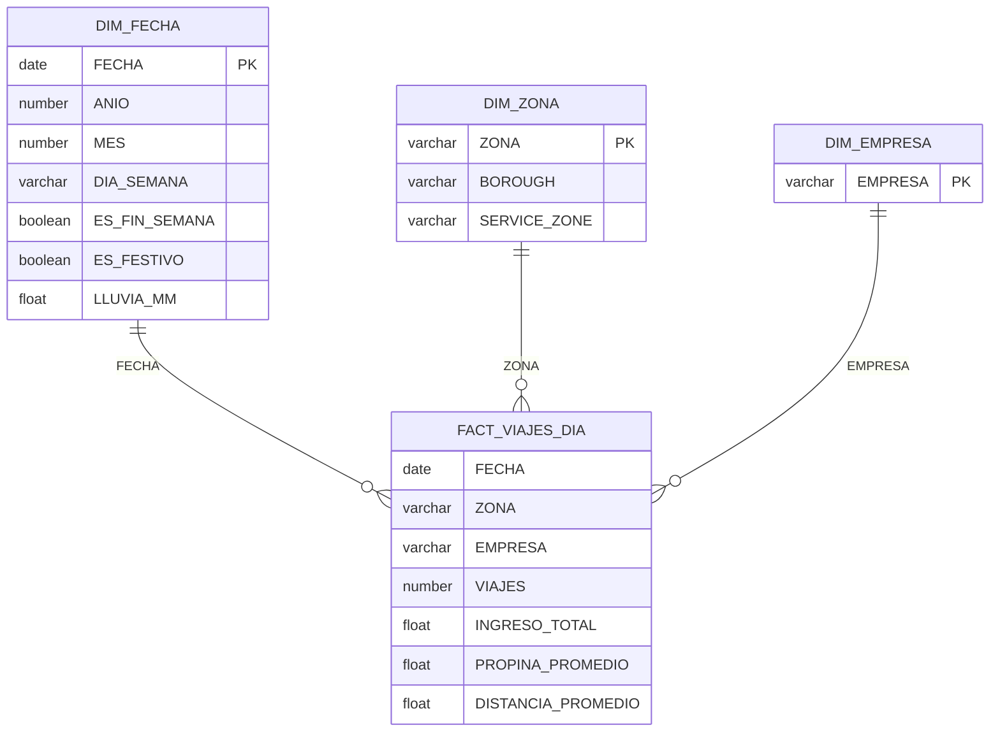

# Diagrama de la estrella · Taller 1

Equipo: Valentina Restrepo Arboleda y Andres Fernando Molina Orozco.

Grano: Una fila por fecha, zona y empresa.

## Claves

| Dimensión | Clave | Por qué es única |
|---|---|---|
| DIM_FECHA | FECHA | Se generó secuencialmente asegurando un único registro por cada día calendario del trimestre. |
| DIM_ZONA | ZONA | Se agrupó usando GROUP BY ZONA, eliminando los LOCATION_ID duplicados para garantizar granularidad única por nombre. |
| DIM_EMPRESA | EMPRESA | Se construyó con un SELECT DISTINCT EMPRESA garantizando que solo existan Uber y Lyft una sola vez. |
